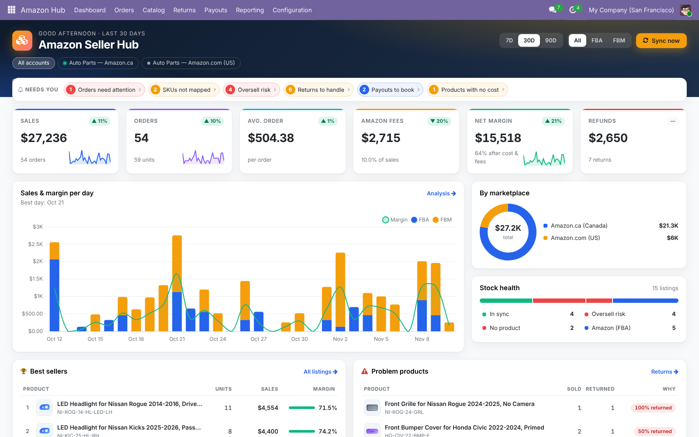

# Amazon Seller Hub for Odoo 19

Connects **Amazon Seller Central (SP-API)** to **Odoo 19**: orders, listings, stock sync, FBA inventory, settlements booked to accounting, returns, and a profit dashboard.

Module: `chi_amazon_connector` · Author: **CH Hamza International** · License: **OPL-1** (paid, Odoo Apps Store)



## Features

| Area | What it does |
|---|---|
| **Accounts** | Multi-account and multi-marketplace (NA / EU incl. Egypt, KSA, UAE / FE). LWA token refresh, sandbox mode, connection test. |
| **Orders** | Imported every 15 minutes (incremental, with overlap). Each order becomes a sale order that is confirmed automatically. FBA deliveries can be validated automatically, and invoices can be created and posted automatically. Cancellations sync back to Odoo. Unmapped SKUs go to a "Needs attention" queue instead of failing silently. |
| **Listings** | SKU, ASIN and price import. Products are mapped automatically by internal reference, barcode or alias. Stock health shows: in sync, oversell risk, under-listed, no product. FBM quantities are pushed with a safety buffer. |
| **FBA inventory** | Fulfillable, inbound, reserved and unfulfillable stock, the difference with the Odoo FBA warehouse, and days of cover. |
| **Settlements** | Financial event groups are split into 11 categories and booked as one balanced journal entry, with multi-currency support. Fees are written back to each order, so the margin is the real margin. |
| **Returns** | Kanban workflow (new → waiting → received → claim → closed) that tracks disposition, refund, reimbursement and net loss. |
| **Dashboard** | OWL client action with KPIs and deltas, sales and margin chart, marketplace split, stock health, best sellers, problem products, payouts and sync activity. |
| **Ops** | Sync log, crons, multi-company rules, User and Administrator groups, credentials hidden from non-admins. |

## Repository layout

```
chi_amazon_connector/
├── models/
│   ├── sp_api.py              # dependency-free SP-API client (LWA, retries/429, pagination, reports)
│   ├── amazon_account.py      # credentials, settings, sync orchestration, crons
│   ├── amazon_order.py        # order import → sale order / delivery / invoice
│   ├── amazon_listing.py      # listings, product mapping, stock health & push
│   ├── amazon_fba_inventory.py
│   ├── amazon_settlement.py   # financial events → journal entry
│   ├── amazon_return.py
│   ├── amazon_dashboard.py    # dashboard data provider
│   └── amazon_demo.py         # realistic demo data (auto-parts seller)
├── static/src/dashboard/      # OWL dashboard (js / xml / scss)
├── static/src/scss/           # shared look for list/kanban/form views
├── views/ wizard/ security/ data/
└── tests/                     # mocked SP-API tests
```

## Run locally

```bash
./odoo-bin -c odoo.conf -d amz_demo -i chi_amazon_connector --with-demo
./odoo-bin -c odoo.conf -d amz_demo --test-tags /chi_amazon_connector --stop-after-init
```

## Amazon setup

1. Seller Central → Apps & Services → Develop Apps → create a private app. Give it these roles: Orders, Inventory & Order Tracking, Finance & Accounting, Product Listing, Amazon Fulfillment.
2. Authorize the app → copy the LWA client id, client secret and refresh token.
3. In Odoo: Amazon Hub → Configuration → Seller Accounts → New → paste the values → **Test connection**.

## Branches

`19.0` is the main branch. Ports to `18.0` and `20.0` will follow, one branch per Odoo version as the Apps Store requires.

---
Amazon is a trademark of Amazon.com, Inc. This module is an independent integration and is not affiliated with Amazon.
